<a href="https://orlandocamc.github.io">
<picture>
  <source media="(prefers-color-scheme: dark)" srcset="assets/header-dark.svg">
  
</picture>
</a>

[Portfolio](https://orlandocamc.github.io) · [LinkedIn](https://www.linkedin.com/in/orlando-camc/)

<picture>
  <source media="(prefers-color-scheme: dark)" srcset="assets/section-recognition-dark.svg">
  
</picture>

<picture>
  <source media="(prefers-color-scheme: dark)" srcset="assets/recognition-dark.svg">
  
</picture>

<picture>
  <source media="(prefers-color-scheme: dark)" srcset="assets/section-featured-dark.svg">
  
</picture>

<a href="https://orlandocamc.github.io/projects/plague-bot-vr/">
<picture>
  <source media="(prefers-color-scheme: dark)" srcset="assets/work-plague-bot-vr-dark.svg">
  
</picture>
</a>

https://github.com/user-attachments/assets/cde103d3-702f-408d-b58b-04f6a7df77c2

Teleoperation HUD on Meta Quest 3 · WebRTC over Tailscale · 40–60 ms latency and 18 FPS video over 4G, in the field (Oaxaca)

What I built: autonomous navigation (ROS 2, Nav2, SLAM, Gazebo), the teleoperation pipeline (WebRTC over Tailscale), the VR HUD for Meta Quest 3, the robot chassis, system integration, and the arm’s motion planning in simulation (MoveIt 2).  
Team credits: PROTÓN 6-DOF arm, Adán López · AI pest detection, Eliot Calderón.

[Project file →](https://orlandocamc.github.io/projects/plague-bot-vr/) · [Showcase repo →](https://github.com/orlandocamc/plague-bot-vr-showcase)

<a href="https://orlandocamc.github.io/projects/rosmaster-slam-stack/">
<picture>
  <source media="(prefers-color-scheme: dark)" srcset="assets/work-rosmaster-slam-stack-dark.svg">
  
</picture>
</a>

Solo project. SLAM, teleoperation and streaming stack for the Yahboom ROSMASTER X3 mecanum robot. My final project for Emerging Technologies, presented at IBERO’s Engineering Day.

[Project file →](https://orlandocamc.github.io/projects/rosmaster-slam-stack/) · [Repository →](https://github.com/orlandocamc/ROSMASTERX3-SLAM-Stack)

<a href="https://orlandocamc.github.io/projects/mr-robot-clients/">
<picture>
  <source media="(prefers-color-scheme: dark)" srcset="assets/work-mr-robot-clients-dark.svg">
  
</picture>
</a>

Solo project, built for Plague-Bot VR and future teleoperation work. The robot’s LiDAR scan, SLAM map and RGB-D point cloud, in a Meta Quest. A custom binary UDP delta protocol sends only the map walls that changed.

[Project file →](https://orlandocamc.github.io/projects/mr-robot-clients/)

<a href="https://orlandocamc.github.io/projects/semillero-ibero/">
<picture>
  <source media="(prefers-color-scheme: dark)" srcset="assets/work-semillero-ibero-dark.svg">
  
</picture>
</a>

Co-founded in August 2026 with Mario Ureña, Moisés López, Martín Santoyo and Joel Arango. Innovation Area Lead. I built the program’s website.

[Project file →](https://orlandocamc.github.io/projects/semillero-ibero/)

<a href="https://orlandocamc.github.io/projects/odometry-ekf/">
<picture>
  <source media="(prefers-color-scheme: dark)" srcset="assets/work-odometry-ekf-dark.svg">
  
</picture>
</a>

Solo project, in simulation.

[Project file →](https://orlandocamc.github.io/projects/odometry-ekf/)

<picture>
  <source media="(prefers-color-scheme: dark)" srcset="assets/section-also-dark.svg">
  
</picture>

| Entry | What it is | Links |
|---|---|---|
| SOMUS-26 | Urban-mobility analysis platform for Mexico City during the 2026 World Cup, with traffic-video analysis | [Repository](https://github.com/orlandocamc/SOMUS-26) · [Demo](https://orlandocamc.github.io/SOMUS-26/) |
| SIGLET | Lab-equipment inventory system (Django, MySQL stored procedures, AWS), team of three: backend with Mario Ureña, plus frontend, chatbot and cloud database | [Repository](https://github.com/orlandocamc/siglet) |
| MindStock | Inventory-management system with computer vision | [Repository](https://github.com/orlandocamc/mindstock) · [Demo](https://mindstock-omega.vercel.app) |

Research: multi-robot coordination with motion capture — research with IBERO faculty.

<picture>
  <source media="(prefers-color-scheme: dark)" srcset="assets/section-toolbox-dark.svg">
  
</picture>

Robotics — ROS 2, Nav2, slam_toolbox, MoveIt 2, ros2_control, robot_localization, Gazebo  
XR and networking — Unity, Meta Quest 3, WebRTC, Tailscale, rosbridge, ZMQ  
Languages — Python, C/C++, C#, Java, SQL  
Hardware — Raspberry Pi 5, ESP32, STM32, RPLIDAR, RealSense, Hailo-8L

<picture>
  <source media="(prefers-color-scheme: dark)" srcset="assets/section-contact-dark.svg">
  
</picture>

<picture>
  <source media="(prefers-color-scheme: dark)" srcset="assets/contact-dark.svg">
  
</picture>

[LinkedIn →](https://www.linkedin.com/in/orlando-camc/) · [Portfolio →](https://orlandocamc.github.io)

Versión en español → [orlandocamc.github.io/es/](https://orlandocamc.github.io/es/)
